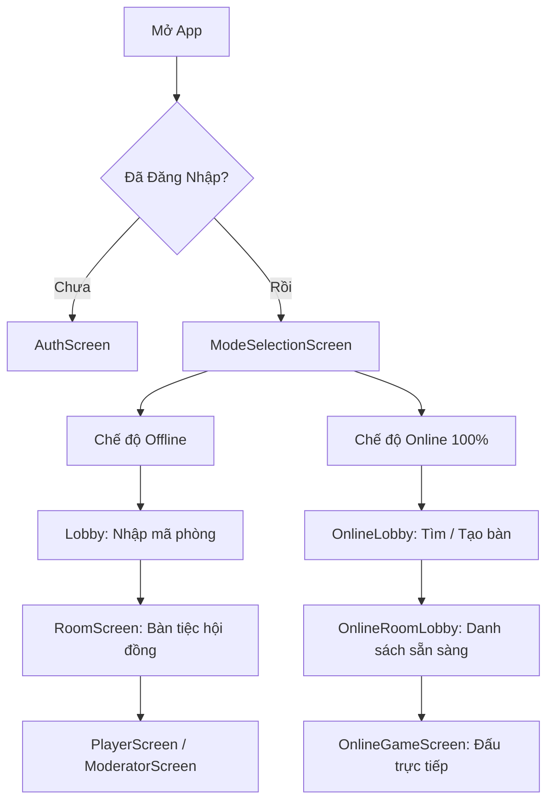

# 🗺️ LỘ TRÌNH HỌC LẬP TRÌNH MOBILE TỪ CON SỐ 0 (DỰ ÁN MA SÓI)

> **Dành cho:** Người mới bắt đầu hoàn toàn, chưa từng lập trình ứng dụng di động.  
> **Mục tiêu:** Nắm vững bản chất lập trình Mobile, tự tin đọc hiểu, sửa đổi và phát triển tiếp dự án Ma Sói bằng **React Native & Expo**.  
> **Phương châm:** *Học chậm mà chắc – Hiểu bản chất – Thực hành ngay trên code thật – Thấy kết quả tức thì trên điện thoại.*

---

## 🧭 MỤC LỤC LỘ TRÌNH

1. [Bản Đồ Tổng Quan 6 Chặng Học](#-1-bản-đồ-tổng-quan-6-chặng-học)
2. [Tư Duy Nền Tảng: Lập Trình Mobile Khác Gì Với Web & Desktop?](#-2-tư-duy-nền-tảng-lập-trình-mobile-khác-gì-với-web--desktop)
3. [Chặng 0: Khởi Động Môi Trường & Chạy App Lần Đầu](#chặng-0-khởi-động-môi-trường--chạy-app-lần-đầu-ngắm-nhìn-thành-quả)
4. [Chặng 1: Những Viên Gạch Nền Móng (Primitives & Giao Diện Cảm Ứng)](#chặng-1-những-viên-gạch-nền-móng-primitives--giao-diện-cảm-ứng)
5. [Chặng 2: Thổi Hồn Vào Giao Diện (State, Props & Tương Tác)](#chặng-2-thổi-hồn-vào-giao-diện-state-props--tương-tác)
6. [Chặng 3: Dòng Chảy Ứng Dụng (Navigation & Vòng Đời Màn Hình)](#chặng-3-dòng-chảy-ứng-dụng-navigation--vòng-đời-màn-hình)
7. [Chặng 4: Đặc Sản Di Động (Haptics Xúc Giác, Lưu Trữ & Danh Sách Cuộn)](#chặng-4-đặc-sản-di-động-haptics-xúc-giác-lưu-trữ--danh-sách-cuộn)
8. [Chặng 5: Đấu Trường Realtime (Mạng LAN, Socket.IO & Luồng Game)](#chặng-5-đấu-trường-realtime-mạng-lan-socketio--luồng-game)
9. [Chặng 6: Nâng Cao & Tốt Nghiệp (Animation 3D, Cử Chỉ Vuốt & Build APK)](#chặng-6-nâng-cao--tốt-nghiệp-animation-3d-cử-chỉ-vuốt--build-apk)
10. [Bảng Theo Dõi Tiến Độ Cá Nhân (Checklist)](#-bảng-theo-dõi-tiến-độ-cá-nhân)

---

## 🌟 1. BẢN ĐỒ TỔNG QUAN 6 CHẶNG HỌC

```text
Chặng 0: Khởi Động          Chặng 1: Viên Gạch           Chặng 2: Sức Sống
[ Cài Expo Go & Chạy ] ➡️   [ View, Text, Flexbox ] ➡️   [ State, Props, Hooks ]
                                                                ⬇️
Chặng 5: Realtime           Chặng 4: Đặc Sản Di Động     Chặng 3: Điều Hướng
[ Socket.IO & Backend ] ⬅️  [ Rung Haptics, Storage ] ⬅️ [ Chuyển Màn & Header ]
       ⬇️
Chặng 6: Nâng Cao & Hoàn Thiện
[ Lật Bài 3D Tarot, Vuốt Chạm & Xuất File APK ]
```

---

## 💡 2. TƯ DUY NỀN TẢN: LẬP TRÌNH MOBILE KHÁC GÌ VỚI WEB & DESKTOP?

Trước khi gõ bất kỳ dòng code nào, bạn cần nắm được **3 sự khác biệt sống còn** của ứng dụng di động:

### 1. Không dùng chuột & bàn phím vật lý — Tất cả là CẢM ỨNG & NGÓN TAY
- Trên Web: Người dùng có con trỏ chuột chính xác từng pixel, có nút bấm chuột phải, di chuột `hover`.
- Trên Mobile: Người dùng thao tác bằng ngón tay cái! 
  - Nút bấm phải đủ to (tối thiểu `44x44` hoặc `48x48` pixel) để không bấm nhầm.
  - Phải có phản hồi thị giác (mờ đi khi bấm) và xúc giác (máy hơi rung nhẹ) để người dùng biết mình đã chạm trúng.

### 2. Màn hình muôn hình vạn trạng & "Vùng cấm" (Safe Area)
- Màn hình điện thoại có: **Tai thỏ (Notch)**, **Camera nốt ruồi (Punch hole)**, **Thanh điều hướng dưới đáy (Home indicator)**.
- Nếu bạn đặt chữ ở góc trên cùng như web, chữ sẽ bị camera che mất! Vì vậy trong React Native luôn cần component `SafeAreaView` để tự động đẩy nội dung vào vùng an toàn.

### 3. Không có thẻ HTML (`<div>`, `<p>`, `<span>`, ``)
React Native không chạy trên trình duyệt, mà chạy trực tiếp trên hệ điều hành Android / iOS:
| Thẻ Web quen thuộc | Component React Native tương đương | Bản chất thực tế trên điện thoại |
| :--- | :--- | :--- |
| `<div>`, `<section>` | `<View>` | Hộp chứa chữ nhật (Android `ViewGroup` / iOS `UIView`) |
| `<p>`, `<h1>`, `<span>` | `<Text>` | Hiển thị chữ. **Bắt buộc mọi chữ phải nằm trong `<Text>`!** |
| `` | `<Image>` | Hiển thị hình ảnh từ file hoặc link mạng |
| `<button>` | `<TouchableOpacity>` hoặc `<Pressable>` | Vùng có thể bấm, tự giảm độ sáng khi ngón tay chạm vào |
| `<input type="text">` | `<TextInput>` | Ô gõ chữ, tự động bật bàn phím ảo của điện thoại |
| `<div style="overflow: scroll">` | `<ScrollView>` hoặc `<FlatList>` | Khung cuộn mượt mà ngón tay |

---

## 🚀 CHẶNG 0: KHỞI ĐỘNG MÔI TRƯỜNG & CHẠY APP LẦN ĐẦU (NGẮM NHÌN THÀNH QUẢ)

> **Mục tiêu:** Tự tay bật được ứng dụng Ma Sói trên chính chiếc điện thoại thật của bạn hoặc trình duyệt để cảm nhận sản phẩm sống động.

### 📖 Bài 0.1: Expo & Metro Bundler là gì?
- **React Native:** Thư viện cho phép viết bằng JavaScript nhưng render ra ứng dụng gốc Android/iOS.
- **Expo:** Là bộ khung (framework) và hệ sinh thái bao quanh React Native giúp bạn không cần cài đặt Android Studio nặng 20GB hay máy Mac/Xcode phức tạp.
- **Expo Go:** Một ứng dụng có sẵn trên Google Play Store (Android) và App Store (iOS). Bạn chỉ cần quét mã QR, code của bạn sẽ truyền thẳng vào điện thoại qua Wi-Fi trong 3 giây!

### 🛠️ Thực hành 0.1: Chạy thử ứng dụng ngay bây giờ
1. Cài ứng dụng **Expo Go** trên điện thoại từ App Store hoặc CH Play.
2. Mở Terminal tại thư mục `mobile` và gõ:
   ```bash
   npm start
   ```
3. Terminal sẽ hiện ra một **mã QR lớn**.
4. Mở camera điện thoại (iOS) hoặc mở Expo Go (Android) để quét mã QR:
   - *Lưu ý:* Điện thoại và máy tính phải **bắt chung một mạng Wi-Fi**.
   - *Nếu khác Wi-Fi hoặc mạng công ty bị chặn:* Dùng lệnh `npm run tunnel` để tạo đường hầm kết nối xuyên Internet.
5. Xem giao diện Game Ma Sói với tông màu Huyết Nguyệt & Dark Gothic hiện lên trên điện thoại của bạn!

---

## 🧱 CHẶNG 1: NHỮNG VIÊN GẠCH NỀN MÓNG (PRIMITIVES & GIAO DIỆN CẢM ỨNG)

> **Mục tiêu:** Hiểu cách dựng một màn hình, biết cách căn chỉnh các phần tử bằng Flexbox và trang trí màu sắc.

### 📖 Bài 1.1: Cấu trúc một màn hình chuẩn
Mở file [`src/screens/AuthScreen.js`](file:///mobile/src/screens/AuthScreen.js) hoặc một component đơn giản.
Mỗi màn hình trong ứng dụng đều có 3 phần chính:
```jsx
// 1. IMPORT CÁC NGUYÊN LIỆU
import React from 'react';
import { View, Text, StyleSheet, TouchableOpacity } from 'react-native';

// 2. COMPONENT VẼ GIAO DIỆN
export default function MyFirstScreen() {
  return (
    <View style={styles.container}>
      <Text style={styles.title}>CHÀO MỪNG ĐẾN LÀNG MA SÓI</Text>
      <TouchableOpacity style={styles.button}>
        <Text style={styles.buttonText}>BẮT ĐẦU</Text>
      </TouchableOpacity>
    </View>
  );
}

// 3. ĐỊNH NGHĨA TRANG TRÍ (CSS-in-JS)
const styles = StyleSheet.create({
  container: {
    flex: 1,
    backgroundColor: '#07050A', // Đá đen obsidian
    justifyContent: 'center',
    alignItems: 'center',
  },
  title: {
    color: '#D4AF37', // Vàng hoàng gia
    fontSize: 20,
    fontWeight: 'bold',
  },
  button: {
    backgroundColor: '#C41E3A', // Đỏ Huyết Nguyệt
    paddingHorizontal: 24,
    paddingVertical: 12,
    borderRadius: 8,
    marginTop: 20,
  },
  buttonText: {
    color: '#FFFFFF',
    fontWeight: '600',
  },
});
```

### 📖 Bài 1.2: Flexbox trên Mobile – Quy tắc đảo ngược so với Web
- Trên Web: `display: flex` mặc định xếp các phần tử theo **hàng ngang (`flexDirection: 'row'`)**.
- Trên Mobile: Màn hình điện thoại dài theo chiều dọc, nên React Native mặc định xếp theo **cột dọc (`flexDirection: 'column'`)**!
- `flex: 1`: Nghĩa là "Hộp này sẽ chiếm toàn bộ khoảng trống còn lại của màn hình".
- `justifyContent`: Căn chỉnh dọc theo trục chính (trên, giữa, dưới, giãn đều).
- `alignItems`: Căn chỉnh ngang theo trục phụ (trái, giữa, phải).

### 🎯 Bài tập thực hành Chặng 1:
- Mở file [`src/constants/theme.js`](file:///mobile/src/constants/theme.js) và [`src/constants/colors.js`](file:///mobile/src/constants/colors.js) để xem bảng màu Gothic Ma Sói được tổ chức như thế nào.
- Thử thay đổi một dòng chữ thông báo trên màn hình [`AuthScreen.js`](file:///mobile/src/screens/AuthScreen.js), lưu lại và quan sát điện thoại tự động tải lại (Fast Refresh) ngay lập tức mà không cần bấm gì!

---

## ⚡ CHẶNG 2: THỔI HỒN VÀO GIAO DIỆN (STATE, PROPS & TƯƠNG TÁC)

> **Mục tiêu:** Làm cho ứng dụng có tính tương tác: ngón tay bấm nút thì dữ liệu thay đổi, giao diện biến hình.

### 📖 Bài 2.1: `useState` – Ký ức của màn hình
Khi chơi game, có những thông tin liên tục biến đổi:
- Người chơi đang chọn phe Dân Làng hay Sói?
- Lá bài đang úp hay ngửa?
- Người chơi đã nhấn "Sẵn Sàng" chưa?
Tất cả những thứ này được lưu trong `useState`:
```jsx
import React, { useState } from 'react';
import { View, Text, TouchableOpacity } from 'react-native';

export function CardReveal() {
  // isRevealed: biến lưu trạng thái (true là đang mở, false là đang úp)
  // setIsRevealed: hàm duy nhất được phép thay đổi biến trên
  const [isRevealed, setIsRevealed] = useState(false);

  return (
    <View>
      <Text>{isRevealed ? "BẠN LÀ MA SÓI! 🐺" : "LÁ BÀI ĐANG ÚP 🃏"}</Text>
      <TouchableOpacity onPress={() => setIsRevealed(!isRevealed)}>
        <Text>{isRevealed ? "Úp bài lại" : "Lật xem vai trò"}</Text>
      </TouchableOpacity>
    </View>
  );
}
```

### 📖 Bài 2.2: `Props` – Truyền thông điệp giữa các khối xây dựng
Trong dự án Ma Sói, bạn sẽ thấy thư mục [`src/components/common/`](file:///mobile/src/components/common/):
- `CustomButton.js`: Một chiếc nút bấm viền vàng tái sử dụng ở 10 màn hình khác nhau.
- `CustomInput.js`: Ô nhập mã phòng hoặc tên người chơi.
Thay vì viết đi viết lại đoạn mã nút bấm, ta tạo 1 component và truyền `props` (`title`, `onPress`, `variant`) vào.

### 📖 Bài 2.3: `useEffect` – Đồng hồ báo thức của Component
- Khi màn hình vừa xuất hiện: Tự động kết nối Socket hoặc nạp thông tin người chơi cũ từ bộ nhớ.
- Khi màn hình chuẩn bị đóng lại: Tắt âm thanh, huỷ bộ đếm giờ (cleanup).

### 🎯 Bài tập thực hành Chặng 2:
- Khám phá file [`src/screens/ModeSelectionScreen.js`](file:///mobile/src/screens/ModeSelectionScreen.js).
- Tìm xem `gameMode` được lưu giữ bằng state nào và khi nhấn vào thẻ "Chế Độ Offline" hay "Đấu Online", hàm nào được kích hoạt.

---

## 🗺️ CHẶNG 3: DÒNG CHẢY ỨNG DỤNG (NAVIGATION & VÒNG ĐỜI MÀN HÌNH)

> **Mục tiêu:** Hiểu cách người chơi đi từ màn hình Đăng Nhập ➡️ Chọn Chế Độ ➡️ Vào Phòng Chờ ➡️ Chơi Game.

### 📖 Bài 3.1: Trung tâm điều phối [`App.js`](file:///mobile/App.js)
Hiện tại, dự án Ma Sói sử dụng cơ chế điều hướng theo trạng thái tập trung trong [`App.js`](file:///mobile/App.js):
- Nếu `!user` ➡️ Hiển thị `AuthScreen` (Bắt đăng nhập).
- Nếu `!gameMode` ➡️ Hiển thị `ModeSelectionScreen` (Chọn chơi Tại Chỗ hay Online).
- Nếu chưa vào phòng ➡️ Hiển thị `LobbyScreen` / `OnlineLobbyScreen`.
- Nếu đã vào phòng ➡️ Hiển thị `RoomScreen` / `OnlineRoomLobbyScreen`.
- Khi ván đấu bắt đầu ➡️ Hiển thị `PlayerScreen` (Người chơi) hoặc `ModeratorScreen` (Quản trò).



### 📖 Bài 3.2: Nút Back vật lý trên điện thoại Android (`BackHandler`)
- Trên iPhone người dùng vuốt mép màn hình, nhưng trên Android có nút Back ở thanh điều hướng hoặc cử chỉ vuốt viền.
- Nếu không xử lý, bấm Back người dùng sẽ bị văng ra khỏi app!
- Trong [`App.js`](file:///mobile/App.js#L95-L105), bạn sẽ học cách lắng nghe sự kiện `BackHandler.addEventListener('hardwareBackPress', ...)` để hỏi: *"Bạn có chắc muốn thoát phòng chơi không?"* thay vì đột ngột thoát app.

---

## 📳 CHẶNG 4: ĐẶC SẢN DI ĐỘNG (HAPTICS XÚC GIÁC, LƯU TRỮ & DANH SÁCH CUỘN)

> **Mục tiêu:** Tận dụng tối đa phần cứng điện thoại để tạo cảm giác ma mị, sống động như đang cầm lá bài thật trên tay.

### 📖 Bài 4.1: Phản hồi xúc giác `expo-haptics`
Game Ma Sói mobile không chỉ có hình và chữ, mà còn "chạm vào cảm xúc" của người chơi:
```javascript
import * as Haptics from 'expo-haptics';

// 1. Nhấn nút bình thường -> Rung nhẹ như bấm phím cơ
Haptics.impactAsync(Haptics.ImpactFeedbackStyle.Light);

// 2. Lật trúng lá bài Tiên Tri / Thợ Săn -> Rung vừa
Haptics.impactAsync(Haptics.ImpactFeedbackStyle.Medium);

// 3. Nửa đêm bị Ma Sói cắn hoặc Bị Treo Cổ -> Rung mạnh dồn dập cảnh báo
Haptics.notificationAsync(Haptics.NotificationFeedbackType.Error);
```

### 📖 Bài 4.2: Lưu thông tin khi tắt app (`AsyncStorage`)
- Khi người chơi tắt hẳn app đi ngủ, sáng mai mở lại họ không muốn phải gõ lại tên và mật khẩu.
- `AsyncStorage` đóng vai trò như chiếc két sắt nhỏ trên điện thoại (tương tự `localStorage` trên web nhưng hoạt động bất đồng bộ `async/await`):
  - Lưu: `await AsyncStorage.setItem('@masoi_user', JSON.stringify(userData));`
  - Đọc: `const savedUser = await AsyncStorage.getItem('@masoi_user');`
  - Xoá khi Đăng Xuất: `await AsyncStorage.removeItem('@masoi_user');`

### 📖 Bài 4.3: Hiển thị danh sách dài với `FlatList`
- Khi phòng có 15 đến 20 người chơi, nếu dùng `View` thông thường điện thoại sẽ bị giật lag.
- `FlatList` là component thần thánh của React Native: Nó chỉ render những người chơi đang hiển thị trên màn hình, người nào bị cuộn khuất sẽ tạm thời được giải phóng bộ nhớ!

---

## 🌐 CHẶNG 5: ĐẤU TRƯỜNG REALTIME (MẠNG LAN, SOCKET.IO & LUỒNG GAME)

> **Mục tiêu:** Hiểu cơ chế các điện thoại nói chuyện với nhau theo thời gian thực (Realtime Multiplayer) qua Socket.IO.

### 📖 Bài 5.1: Bẫy "Localhost" kinh điển của người mới
- Trên máy tính, bạn thường gõ `http://localhost:5000` để kết nối server backend.
- Nhưng khi chạy trên **điện thoại thật**, `localhost` chính là... chiếc điện thoại đó, chứ không phải máy tính của bạn!
- Vì vậy, điện thoại phải kết nối qua **Địa chỉ IP mạng LAN nội bộ** (ví dụ: `http://192.168.1.15:5000`).
- Mở file [`src/constants/config.js`](file:///mobile/src/constants/config.js) để xem nơi cấu hình IP máy tính.

### 📖 Bài 5.2: Cơ chế Socket.IO trong Game Ma Sói
Mở file [`src/services/socket.js`](file:///mobile/src/services/socket.js) và [`src/constants/socketEvents.js`](file:///mobile/src/constants/socketEvents.js):
1. **Lắng nghe sự kiện từ Server (`socket.on`)**:
   - Khi trời tối: Server gửi event `NIGHT_PHASE_STARTED` ➡️ Màn hình điện thoại tự động chuyển sang màu tím thẫm Huyết Nguyệt.
   - Khi có người chết: Server gửi `PLAYER_DIED` ➡️ Bật còi rung Haptics và hiển thị modal Hồn Ma.
2. **Gửi hành động lên Server (`socket.emit`)**:
   - Sói chọn cắn ai: `socket.emit('WEREWOLF_KILL_VOTE', { targetId })`.
   - Tiên Tri soi bài: `socket.emit('SEER_REVEAL', { targetId })`.

---

## 🔮 CHẶNG 6: NÂNG CAO & TỐT NGHIỆP (ANIMATION 3D, CỬ CHỈ VUỐT & BUILD APK)

> **Mục tiêu:** Tinh chỉnh các hiệu ứng đỉnh cao và đóng gói thành file cài đặt `.apk` để gửi cho bạn bè cùng chơi.

### 📖 Bài 6.1: Hoạt ảnh lật bài 3D Tarot (`react-native-reanimated`)
- Khám phá [`src/screens/PlayerScreen.js`](file:///mobile/src/screens/PlayerScreen.js).
- Lá bài Tarot xoay 180 độ theo trục Y (`rotateY: '180deg'`) mượt mà 60fps nhờ thư viện Reanimated tính toán trực tiếp trên chip đồ hoạ (GPU) của điện thoại.

### 📖 Bài 6.2: Bảng điều khiển Quản Trò & Sheet kéo vuốt (`@gorhom/bottom-sheet`)
- Thay vì dùng popup cứng nhắc, ngón tay có thể vuốt nhẹ từ đáy màn hình lên để mở bảng danh sách nạn nhân đêm nay.
- Mở xem [`src/components/online/MobileNightActionSheet.js`](file:///mobile/src/components/online/MobileNightActionSheet.js).

### 📖 Bài 6.3: Xuất file cài đặt Android (APK) bằng Expo EAS
Khi muốn chia sẻ cho bạn bè mà không cần cài Expo Go:
```bash
# Đăng nhập tài khoản Expo miễn phí
npx eas-cli login

# Lệnh đóng gói file APK cài trực tiếp vào mọi máy Android
npx eas-cli build -p android --profile preview
```
Hệ thống máy chủ đám mây của EAS sẽ tự động biên dịch và trả về cho bạn một đường link tải file `.apk`.

---

## 📋 BẢNG THEO DÕI TIẾN ĐỘ CÁ NHÂN

Hãy đánh dấu `[x]` vào từng mục khi bạn đã thực hành và hiểu được bài học:

### Chặng 0: Khởi động
- [ ] Cài đặt Expo Go trên điện thoại cá nhân.
- [ ] Chạy thành công `npm start` trong thư mục `mobile` và quét mã QR vào app.
- [ ] Nắm được vai trò của Metro Bundler và Fast Refresh.

### Chặng 1: Nền tảng Giao diện
- [ ] Hiểu rõ 5 viên gạch cơ bản: `View`, `Text`, `Image`, `TouchableOpacity`, `TextInput`.
- [ ] Nắm vững cách xếp hộp Flexbox (`column` vs `row`, `alignItems`, `justifyContent`).
- [ ] Đọc hiểu file [`src/constants/theme.js`](file:///mobile/src/constants/theme.js) và tự đổi được một màu sắc/dòng chữ trong `AuthScreen.js`.

### Chặng 2: Logic & Tương tác
- [ ] Dùng `useState` để lưu một giá trị đóng/mở (ví dụ lật bài).
- [ ] Dùng `props` để truyền dữ liệu từ Component Cha sang Con.
- [ ] Hiểu được `useEffect` chạy khi nào trong vòng đời của màn hình.

### Chặng 3: Điều hướng
- [ ] Đọc hiểu luồng chuyển cảnh trong [`App.js`](file:///mobile/App.js).
- [ ] Biết cách bảo vệ giao diện khỏi tai thỏ/nốt ruồi bằng `SafeAreaView`.
- [ ] Biết cách chặn nút Back vật lý của Android bằng `BackHandler`.

### Chặng 4: Tính năng Di động
- [ ] Tự thêm được hiệu ứng rung `Haptics.impactAsync` vào một nút bấm.
- [ ] Lưu và đọc được dữ liệu phiên đăng nhập qua `AsyncStorage`.
- [ ] Hiểu vì sao danh sách người chơi nên dùng `FlatList` thay vì map thông thường.

### Chặng 5: Mạng & Realtime
- [ ] Biết cách xem IP máy tính bằng `ipconfig` và cấu hình vào `src/constants/config.js`.
- [ ] Hiểu luồng gửi `socket.emit` và nhận `socket.on` trong game.
- [ ] Thử kết nối 2 thiết bị (1 điện thoại thật + 1 trình duyệt web) vào chung 1 phòng chơi.

### Chặng 6: Hoàn thiện
- [ ] Đọc hiểu component lật bài 3D trong `PlayerScreen.js`.
- [ ] Trải nghiệm bảng vuốt đáy BottomSheet trong `MobileNightActionSheet.js`.
- [ ] Tìm hiểu quy trình build file `.apk` độc lập qua EAS.

---

> 💬 **Lời khuyên từ Huấn Luyện Viên:**  
> Đừng cố học thuộc lòng code! Hãy bắt đầu từ việc **đọc code có sẵn trong dự án**, đặt câu hỏi *"Dòng này để làm gì?"*, thử sửa một giá trị nhỏ (đổi màu, đổi chữ, đổi độ rung) và nhìn kết quả thay đổi ngay trên tay bạn. Tôi sẽ luôn ở đây để giải thích từng dòng code một cách dễ hiểu nhất cho bạn!
